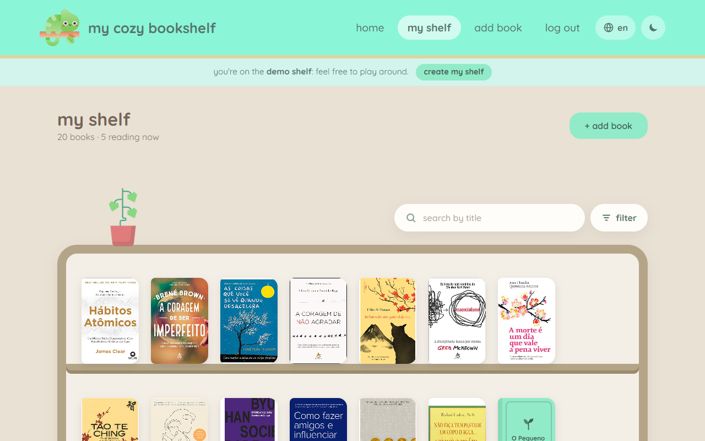
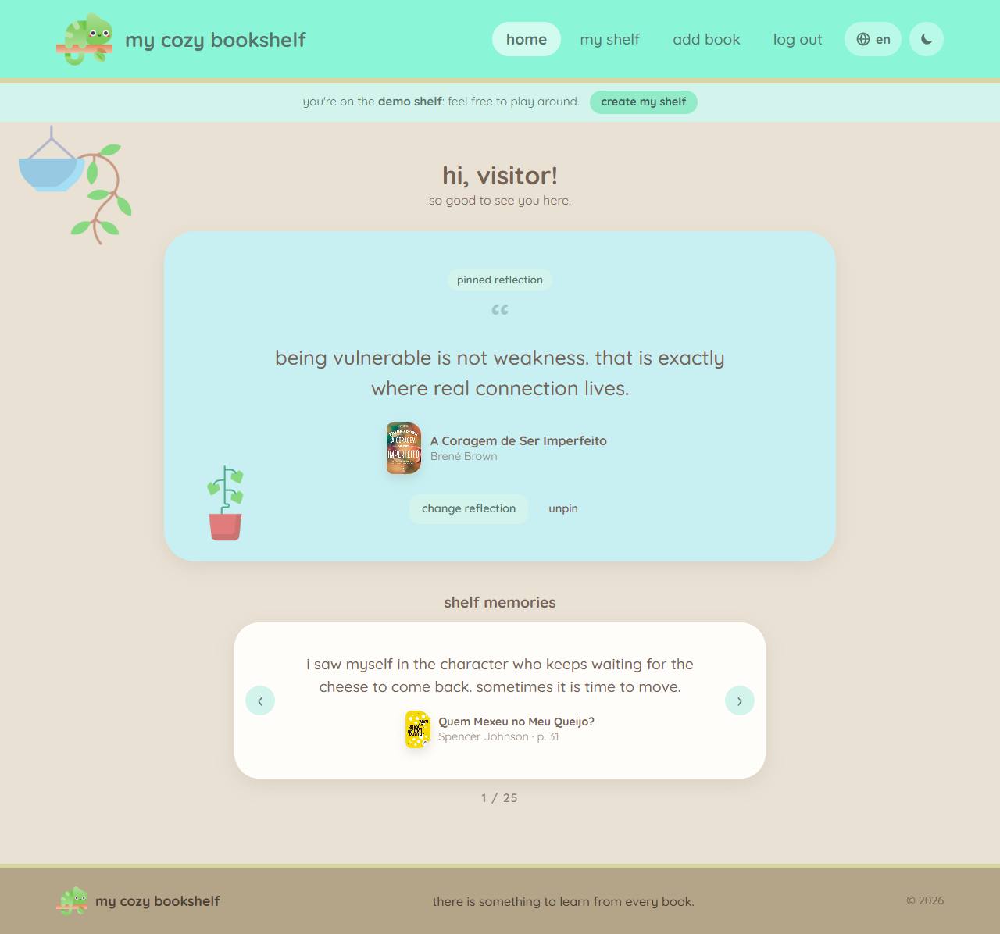
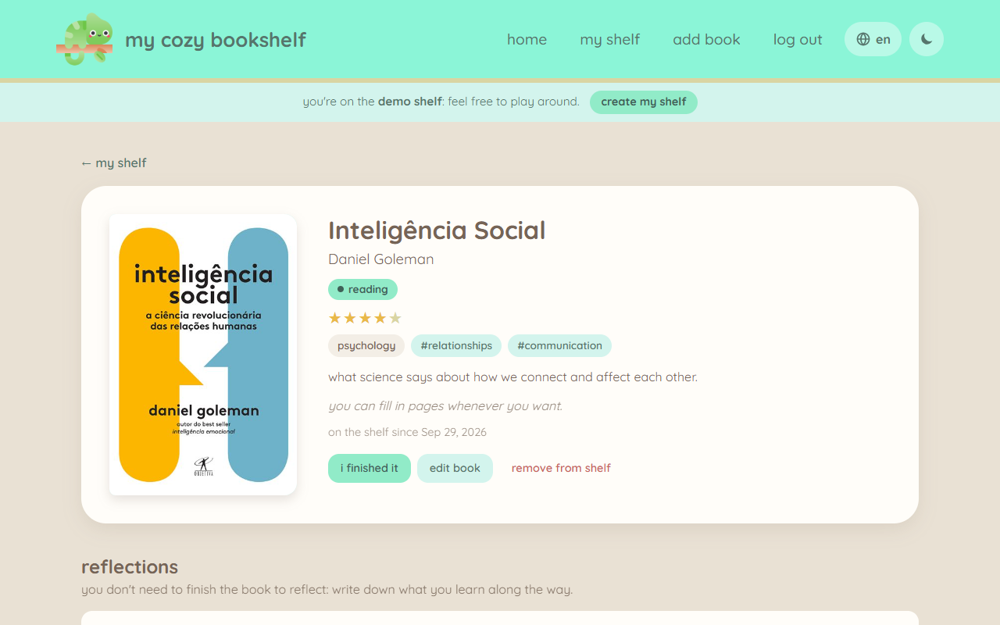
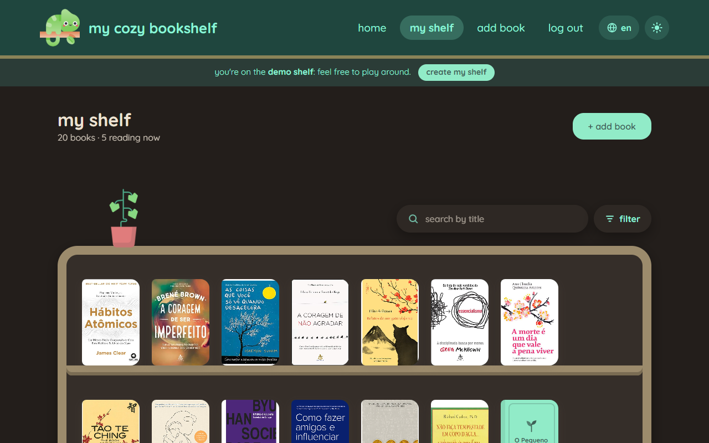
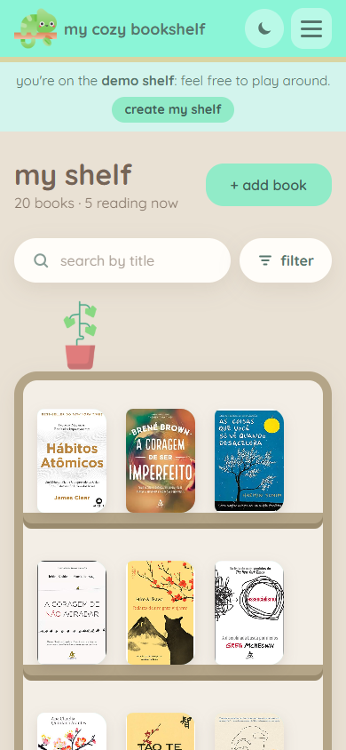
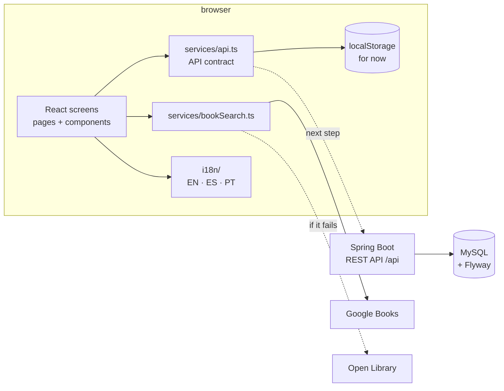

<p align="center">
  
</p>

<h1 align="center">my cozy bookshelf</h1>

<p align="center">
  a cozy corner to keep the books you read<br />
  and everything they left in you. 🌿
</p>

<p align="center">
  🔗 <strong>live demo:</strong> <em>coming soon</em> · click <strong>see the demo</strong> to open a shelf already full of books
</p>

<p align="center">
  
  
  
  
  
  
  
  
</p>

<p align="center">
  
</p>

> **in 30 seconds** ⏱️
>
> - **what:** a private reading journal: a visual bookshelf, reflections for each book (even while you're still reading it) and one reflection pinned to the home page
> - **stack:** React 19 + TypeScript + Vite on the frontend · Java 21 + Spring Boot 4.1 + MySQL + Flyway on the backend
> - **status:** the MVP frontend is complete and works with data stored in the browser; the backend REST API is the next step ([see below](#next-steps))
> - **technical highlights:** book search with a fallback between two APIs, light/dark theme built on design tokens, three languages (English, Spanish, Portuguese) with type-checked translations, full keyboard navigation, demo mode, only 3 production dependencies
> - **where to look first:** [`services/api.ts`](frontend/src/services/api.ts) · [`services/bookSearch.ts`](frontend/src/services/bookSearch.ts) · [`i18n/`](frontend/src/i18n) · [`pages/Shelf.tsx`](frontend/src/pages/Shelf.tsx) · [`AI Guide/Plan/Plan.md`](AI%20Guide/Plan/Plan.md)

---

## hi, so good to see you here!

**my cozy bookshelf** is a private bookshelf. Each person keeps the books they have read and writes the **reflections** each one left them with: a sentence that stuck, a feeling, something that changed after the reading.

Nobody sells anything and nobody watches what you read. The shelf is yours alone.

### every book has a lesson 🌱

This is the idea behind the project. It's not only self-help or psychology books that teach: a novel, a fantasy story or a classic also leave something in us. Sometimes it's a character, sometimes a scene, sometimes a new way of looking at life.

That's why, when you write a reflection, the site suggests questions that fit the book. For a fiction book you might see *"which character taught you something?"*, and if nothing comes to mind, the **give me an idea** button draws another one.

And the chameleon? It changes color depending on where it is. Here, it **picks up a little of the color of every book it reads**, because there is something to learn from every book. 🦎

> The project started as **ajuda.me**, a small self-help bookstore built with plain HTML and JavaScript.
> It grew, changed its mind and became something else. Now it's a fullstack **Spring Boot + React** project,
> and the chameleon came along. 🦎

## what you can do

- **create your account** and come back whenever you want
- **put a book on the shelf**: only the title is required. Author, cover, summary, genre, page count, tags, stars and a reflection can come right away or later, calmly
- **find the book without typing everything**: while you type the title, the site looks the book up (on Google Books and Open Library) and fills in author, cover, pages and genre
- **see your books on a real-looking shelf**, side by side on wooden planks
- **search your shelf** by title and filter by genre, tags or reading status
- **write reflections** on each book, as many as you want, and note the page you were on. You don't need to finish a book to reflect on it: mark it as *reading* and take notes along the way
- **finish a reading** with one click: the chameleon pops up asking for your final reflection on the book
- **pin a reflection to the home page**: one of your reflections, or one you write just for that spot
- **rediscover what you wrote**: below the pinned reflection, the *shelf memories* slowly go by, one reflection at a time
- **read at night**: there is a light and a dark theme, on the sun/moon button at the top
- **use it in your language**: English, Spanish or Portuguese, on the globe button. It starts in your browser's language and remembers your choice

A book without a cover doesn't look sad: the site makes a cute cover with the shelf colors and the title written on it.

And for anyone who just wants to take a look, there is **demo mode**: one click on *see the demo* (on the home page or on login) opens a shelf with 20 books, reflections, books being read and a reflection pinned to the home page, in the language you are using. Feel free to play around, it is rebuilt from scratch every time.

| home                                  | book page                             |
|---------------------------------------|---------------------------------------|
|     |     |

| dark theme                                       | on mobile                                                          |
|--------------------------------------------------|--------------------------------------------------------------------|
|    |  |

## its little ways

The look follows a few small rules, to stay cozy:

- the **chameleon** is the mascot and shows up in the header, the footer and the login screens
- the colors are the original project's **mint blue**, **green** and **brown**, on a beige background
- there are **little plants** around the house
- everything is **rounded, cute, simple and flat**, with nothing extra
- the font is **Quicksand**, and the texts are lowercase, like a conversation

The full plan, with palette, screens and rules, is in [`AI Guide/Plan/Plan.md`](AI%20Guide/Plan/Plan.md). It is the basis for any change to the project, including the ones made with the help of AI.

## under the hood 🔧

This part is for anyone who wants to understand how the project was built.

### architecture



The screens never touch the data directly: they only call the async functions in [`services/api.ts`](frontend/src/services/api.ts), which already have the shape of the REST API. Today those functions store everything in `localStorage`. Once the backend exists, only their bodies change to `fetch('/api/...')`, and no screen needs to change.

### technical highlights

- **Resilient book search** ([`bookSearch.ts`](frontend/src/services/bookSearch.ts), [`TitleSearch.tsx`](frontend/src/components/TitleSearch.tsx))
  - waits for the person to stop typing (450 ms debounce) and cancels outdated searches with `AbortController`
  - tries Google Books and, if it fails (for example, a quota limit) or finds nothing, uses Open Library
  - maps the APIs' categories to the app's genres; covers that don't exist become the placeholder cover
  - it's an accessible *combobox*: arrows, Enter and Esc work, with `aria-activedescendant`
- **Three languages without an i18n library** ([`i18n/`](frontend/src/i18n))
  - each language is a plain TypeScript object; English is the reference, and `const pt: Messages = {...}` makes the compiler fail if a translation is missing or has the wrong shape
  - dates and lists use the native `Intl.DateTimeFormat` and `Intl.ListFormat` ("author, pages and tags")
  - errors from the API are codes (`AppError('needTitle')`), translated only on screen
  - the starting language comes from the browser, `<html lang>` follows the choice, and the demo data and reflection prompts exist in all three languages
- **Custom design system, no UI library**: the whole look is hand-written CSS with *design tokens* (CSS variables) in [`index.css`](frontend/src/index.css). The dark theme is just another set of values under `:root[data-theme='dark']`, and a script in [`index.html`](frontend/index.html) applies the theme before the page shows, so it never flashes light.
- **State in the URL**: the shelf search and filters live in the query string (`?genre=novel&tag=classic&status=reading`), so reloading the page or coming back from a book keeps everything as it was.
- **Components with attention to detail**
  - the bookcase works out how many books fit on each shelf with `ResizeObserver`
  - the placeholder cover uses *container queries* (`cqw`) so the text follows the cover size
  - the carousel pauses on hover, on focus or with `prefers-reduced-motion`
  - the "i finished it" window uses the browser's native `<dialog>`, which already handles focus and Esc
- **Few dependencies**: in production only `react`, `react-dom` and `react-router`.
- **Code quality**: TypeScript in strict mode (the build runs `tsc -b`) and linting with [oxlint](https://oxc.rs).
- **Backend ready to grow**: Spring Boot 4.1 with versioned Flyway migrations, Hibernate in `validate` mode (the schema never changes on its own), Actuator for health checks, Lombok, and the Vite proxy for `/api` in development.

### accessibility and responsiveness

- everything works with the keyboard: search, filters, carousel, side menu, language menu and dialogs; focus is always visible
- icon-only buttons have labels (`aria-label`), and option groups use `role="radiogroup"` and `aria-pressed`
- it follows the system preferences: theme (`prefers-color-scheme`), less motion (`prefers-reduced-motion`) and language
- contrast tuned in both themes (for example, the footer text in the dark theme)
- on mobile, the menu becomes a side drawer (with the language choice inside it) and forms use a single column; the interface was checked on 390 px screens

### decisions and trade-offs

| decision | why | the cost |
|---|---|---|
| build the frontend before the backend | validate the experience quickly, with fake data that already follows the API contract | for now the data only lives in the browser |
| own CSS instead of Tailwind or MUI | the visual identity is very specific, and the project has fewer dependencies | more CSS to maintain |
| own i18n instead of i18next | three languages and a few hundred strings fit in typed objects, with compile-time checks and zero dependencies | no pluralization engine or lazy loading (not needed at this size) |
| the search does **not** fill in the summary | the summary should be written in the person's own words, which is the point of the project | one field less filled in automatically |
| optional Google Books key | the project runs without any setup | without a key the quota is shared per IP; Open Library covers it when it runs out |
| demo book titles stay in Portuguese | they match the Brazilian editions on the covers | in English and Spanish the titles don't match the interface language |
| books without a status count as "read" | data saved before the "reading" status still works | none |

## where things stand

| part           | status                                                                                                   |
|----------------|----------------------------------------------------------------------------------------------------------|
| **frontend**   | first version of every MVP screen: home, login, sign-up, shelf, add book and book page, in three languages |
| **backend**    | structure ready (Spring Boot, MySQL, Flyway), but no endpoints yet for users, books and reflections       |
| **tests**      | no automated tests yet; every feature was checked in the browser (light and dark theme, desktop and mobile, three languages) |

Until the backend is ready, the frontend stores everything **in the browser itself** (`localStorage`), in [`frontend/src/services/api.ts`](frontend/src/services/api.ts).
The functions in that file already have the shape of the final API. When the endpoints exist, only they change and the screens stay as they are.

> ⚠️ Because of that, today's data only exists in the browser where it was created, and the password is not protected.
> Use it just for testing, no real passwords for now.

## running it on your machine

### what you need

- **Java 21**
- **Node 24+**
- **MySQL** running on `localhost:3306` (backend only). The `mycozybookshelf` database is created automatically on the first run

### frontend 🌱

For now, the frontend alone is enough to see and use the site:

```bash
cd frontend
npm install
npm run dev
```

Then open **http://localhost:5173**, create an account and start filling your shelf.

The book search works without any setup. If you want your own Google Books quota, copy `frontend/.env.example` to `frontend/.env.local` and put your key in `VITE_GOOGLE_BOOKS_API_KEY`. That key is visible in the browser, so restrict it to the site's domain in Google Cloud. On Vercel, the same variable goes in *Settings → Environment Variables*.

Other useful commands:

```bash
npm run build   # type-checks and builds the final version into frontend/dist
npm run lint    # looks for little problems in the code
```

### backend ☕

On port 8080 (PowerShell example):

```powershell
cd backend
$env:DB_USERNAME="root"; $env:DB_PASSWORD="your_password"
.\mvnw.cmd spring-boot:run
```

Supported variables: `DB_URL`, `DB_USERNAME` and `DB_PASSWORD` (see `backend/src/main/resources/application.properties`).

In development, Vite forwards everything starting with `/api` to `http://localhost:8080`, so there is no need to configure CORS.

> On Windows behind a corporate proxy, prefer `mvnw.cmd`: the bash `./mvnw` uses Windows' curl, which can fail the certificate revocation check through the proxy.

#### endpoints that already exist

- `GET /api/hello`: sample endpoint
- `GET /actuator/health`: tells whether the app and the database are fine

#### database

The schema is versioned with **Flyway** in `backend/src/main/resources/db/migration` (`V1__init.sql`, `V2__...`).
Hibernate runs in `validate` mode: it checks the tables but never changes anything.

## publishing it 🚀

While the data lives in the browser, the frontend works on its own and can be published for free as a static site. The simplest way is **Vercel**:

1. sign in at [vercel.com](https://vercel.com) with your GitHub account and import this repository
2. under **Root Directory**, pick `frontend` (Vercel figures out the rest: build `npm run build`, output `dist`)
3. deploy, then put the link at the top of this README 🎉

The [`frontend/vercel.json`](frontend/vercel.json) file makes pages like `/shelf` and `/book/...` open correctly even when someone reloads the page or opens the link directly.
Every push to the configured branch updates the site automatically.

Once the backend is ready, Spring Boot and MySQL go to another service (Render, Railway or Fly.io, for example), and the frontend stays on Vercel.

## where everything lives

```
my-cozy-bookshelf/
├── AI Guide/
│   ├── Plan/Plan.md            # the project plan (read it before changing anything!)
│   ├── Assets/                 # chameleon, little plants and font
│   └── References/             # screens of the original ajuda.me
├── docs/screenshots/           # images used in this README
├── backend/                    # Java 21 + Spring Boot 4.1 + MySQL + Flyway
└── frontend/                   # React + Vite + TypeScript
    ├── public/demo/            # covers of the demo books
    └── src/
        ├── pages/              # screens (home, shelf, book, login...)
        ├── components/         # header, cover, search, carousel, finish dialog...
        ├── i18n/               # translations (en, es, pt), genres and language context
        ├── services/
        │   ├── api.ts          # API contract (stores in the browser for now)
        │   ├── bookSearch.ts   # Google Books / Open Library search
        │   └── demoData.ts     # demo mode books, in the three languages
        ├── auth/               # login and protected pages
        └── utils/              # reflection prompts, reading helpers, images
```

## next steps

1. **REST API in Spring Boot** for users, books, reflections and the pinned reflection: JPA entities, Flyway migrations and DTOs as `record`s
2. **Real authentication** with Spring Security and hashed passwords (BCrypt)
3. **Automated tests**: Vitest + Testing Library for components, Playwright for the main flows (demo, adding a book, finishing a reading, switching language) and JUnit + Testcontainers for the API
4. **CI on GitHub Actions** running lint, build and tests on every pull request
5. **Book search through the backend**, so the Google key doesn't live in the browser
6. **PWA** (installable on the phone) and, later on, store apps with Capacitor

## how it was built

- [`Plan.md`](AI%20Guide/Plan/Plan.md) works as a living spec: visual identity, screens, rules and decisions are written there before they become code
- development was iterative, in short *idea → implementation → check in the browser → adjust* cycles, with the help of AI (Claude Code) following the plan
- every visual change was checked in both themes, on desktop and mobile screens

## who made it

Made by **Beatriz**, [@helloimbea](https://github.com/helloimbea) on GitHub.
<!-- tip: add your LinkedIn or portfolio link here -->

## license

Distributed under the MIT license. The details are in [`LICENSE`](LICENSE).

<p align="center">made with care 🦎📚</p>
