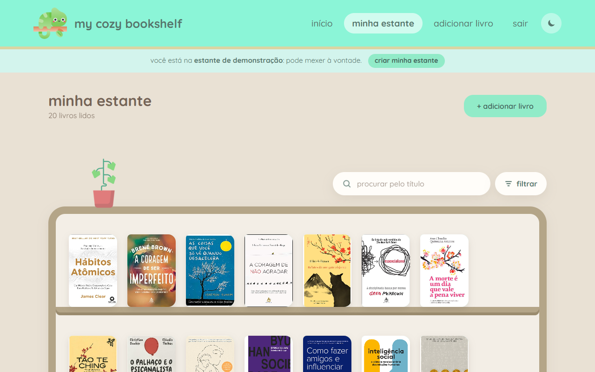
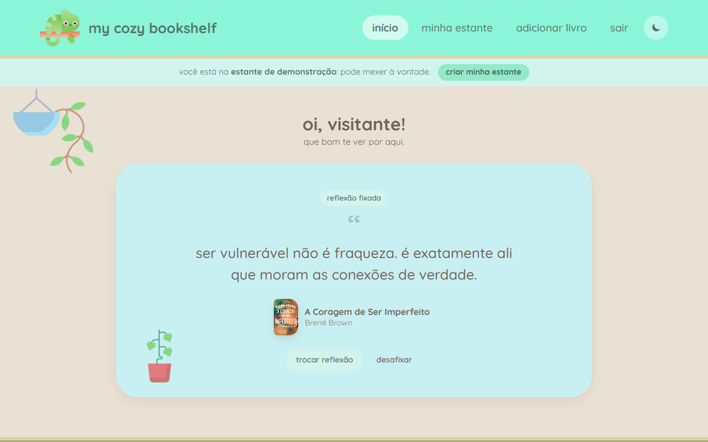
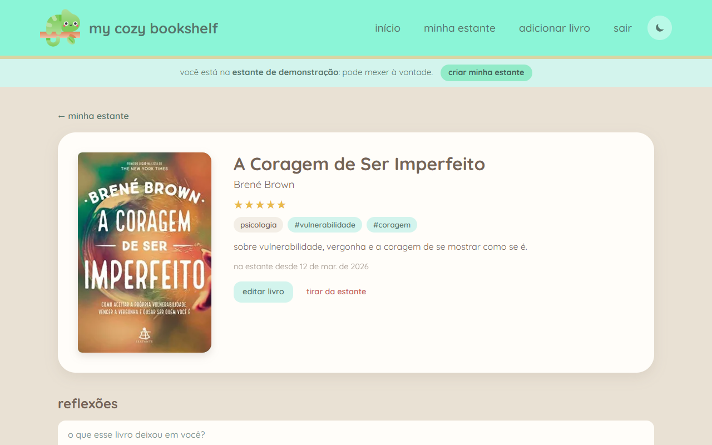
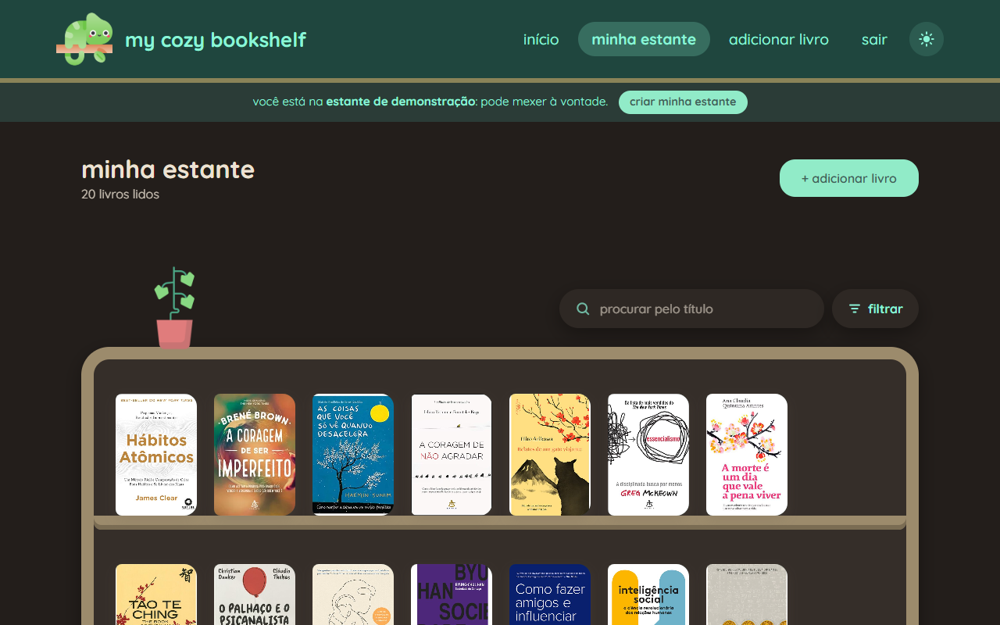
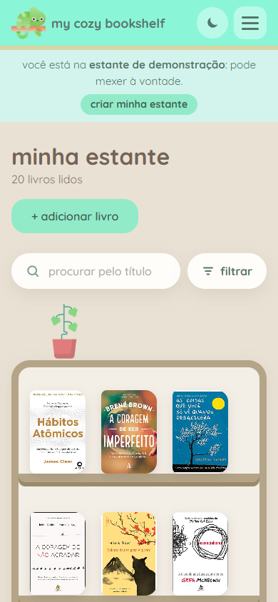

<p align="center">
  
</p>

<h1 align="center">my cozy bookshelf</h1>

<p align="center">
  um cantinho pra guardar os livros que você leu<br />
  e tudo o que eles deixaram em você. 🌿
</p>

<p align="center">
  🔗 <strong>veja ao vivo:</strong> <em>em breve</em> · clique em <strong>ver demonstração</strong> pra entrar numa estante já cheia de livros
</p>

<p align="center">
  
</p>

---

## oi, que bom te ver por aqui!

O **my cozy bookshelf** é uma estante particular. Cada pessoa guarda nela os livros que já leu e escreve as **reflexões** que teve com cada um: uma frase que ficou na cabeça, um sentimento, algo que mudou depois da leitura.

Ninguém vende nada nem fica de olho no que você lê. A estante é só sua.

> O projeto nasceu como o **ajuda.me**, uma lojinha de livros de autoajuda feita em HTML e JavaScript puro.
> Ele cresceu, mudou de ideia e virou outra coisa. Agora é um projeto fullstack em **Spring Boot + React**,
> e o camaleão veio junto. 🦎

## o que dá pra fazer

- **criar sua conta** e entrar quando quiser
- **colocar um livro na estante**: só o título é obrigatório. Autor, capa, resumo, gênero, número de páginas, tags, estrelas e reflexão podem vir na hora ou depois, com calma
- **ver seus livros numa prateleira de verdade**, um do lado do outro, em cima das tábuas de madeira
- **procurar na estante** pelo título e filtrar por gênero ou por tags
- **escrever reflexões** em cada livro, quantas quiser
- **fixar uma reflexão no início**: a tela inicial mostra a reflexão que você escolheu, ou uma que você escreveu só pra ela
- **ler de noite**: tem tema claro e escuro, no botão de sol/lua do topo

Livro sem capa não fica feio: o site faz uma capinha fofa com as cores da estante e o título escrito nela.

E pra quem só quer dar uma olhadinha, tem o **modo demonstração**: um clique em *ver demonstração* (no início ou no login) abre uma estante com 20 livros, reflexões e uma reflexão fixada no início. Dá pra mexer à vontade, ela é recriada do zero a cada vez.

| início                                   | página do livro                        |
|------------------------------------------|----------------------------------------|
|    |    |

| tema escuro                                          | no celular                                                   |
|------------------------------------------------------|--------------------------------------------------------------|
|   |  |

## o jeitinho dele

O visual segue algumas regrinhas, para continuar aconchegante:

- o **camaleão** é o mascote e aparece no topo, no rodapé e nas telas de entrada
- as cores são o **azul menta**, o **verde** e o **marrom** do projeto original, com fundo bege
- tem **plantinhas** espalhadas pela casa
- tudo é **arredondado, fofo, simples e flat**, sem excessos
- a fonte é a **Quicksand**, e os textos são em minúsculas, com tom de conversa

O plano completo, com paleta, telas e regras, está em [`AI Guide/Plan/Plan.md`](AI%20Guide/Plan/Plan.md). Ele é a base para qualquer mudança no projeto, inclusive as feitas com ajuda de IA.

## como está agora

| parte          | situação                                                                                                   |
|----------------|------------------------------------------------------------------------------------------------------------|
| **frontend**   | primeira versão de todas as telas do MVP: início, login, cadastro, estante, adicionar livro e página do livro |
| **backend**    | estrutura pronta (Spring Boot, MySQL, Flyway), mas ainda sem as rotas de usuários, livros e reflexões       |

Enquanto o backend não fica pronto, o frontend guarda tudo **no próprio navegador** (`localStorage`), em [`frontend/src/services/api.ts`](frontend/src/services/api.ts).
As funções desse arquivo já têm o formato da API final. Quando os endpoints existirem, só elas mudam e as telas ficam como estão.

> ⚠️ Por isso, os dados de agora só existem no navegador em que foram criados, e a senha não é protegida.
> Use só para testar, nada de senha de verdade por enquanto.

## pra rodar na sua máquina

### o que você precisa

- **Java 21**
- **Node 24+**
- **MySQL** rodando em `localhost:3306` (só para o backend). O banco `projeto` é criado sozinho na primeira execução

### frontend 🌱

Por enquanto, só o frontend já basta para ver e usar o site:

```powershell
cd frontend
npm install
npm run dev
```

Depois é só abrir **http://localhost:5173**, criar uma conta e começar a encher a estante.

Outros comandos úteis:

```powershell
npm run build   # confere os tipos e gera a versão final em frontend/dist
npm run lint    # procura probleminhas no código
```

### backend ☕

No PowerShell (porta 8080):

```powershell
cd backend
$env:DB_USERNAME="root"; $env:DB_PASSWORD="sua_senha"
.\mvnw.cmd spring-boot:run
```

Variáveis aceitas: `DB_URL`, `DB_USERNAME` e `DB_PASSWORD` (ver `backend/src/main/resources/application.properties`).

Em desenvolvimento, o Vite encaminha tudo que começa com `/api` para `http://localhost:8080`, então não é preciso configurar CORS.

> Na rede Bosch use `mvnw.cmd`. O `./mvnw` (bash) usa o curl do Windows, que falha na checagem de revogação de certificado através do proxy.

#### endpoints que já existem

- `GET /api/hello`: endpoint de exemplo
- `GET /actuator/health`: diz se a aplicação e o banco estão bem

#### banco de dados

O schema é versionado pelo **Flyway** em `backend/src/main/resources/db/migration` (`V1__init.sql`, `V2__...`).
O Hibernate fica em modo `validate`: ele confere as tabelas, mas nunca altera nada.

## pra publicar 🚀

Enquanto os dados ficam no navegador, o frontend funciona sozinho e pode ser publicado de graça como site estático. O jeito mais simples é a **Vercel**:

1. entrar em [vercel.com](https://vercel.com) com a conta do GitHub e importar este repositório
2. em **Root Directory**, escolher `frontend` (o resto a Vercel descobre sozinha: build `npm run build`, saída `dist`)
3. publicar, e depois colocar o link lá no topo deste README 🎉

O arquivo [`frontend/vercel.json`](frontend/vercel.json) faz páginas como `/estante` e `/livro/...` abrirem direitinho mesmo quando alguém atualiza a página ou abre o link direto.
Cada push na branch configurada atualiza o site sozinho.

Quando o backend estiver pronto, o Spring Boot e o MySQL vão para outro serviço (Render, Railway ou Fly.io, por exemplo), e o frontend continua na Vercel.

## onde fica cada coisa

```
my-cozy-bookshelf/
├── AI Guide/
│   ├── Plan/Plan.md        # o plano do projeto (leia antes de mudar algo!)
│   ├── Assets/             # camaleão, plantinhas e fonte
│   └── References/         # telas do ajuda.me original
├── docs/screenshots/       # imagens usadas neste README
├── backend/                # Java 21 + Spring Boot 4.1 + MySQL + Flyway
└── frontend/               # React + Vite + TypeScript
    └── src/
        ├── pages/          # as telas (início, estante, livro, login...)
        ├── components/     # header, rodapé, capa, estrelas, formulário...
        ├── services/api.ts # conversa com os dados (hoje no navegador)
        └── services/demoData.ts # os livros do modo demonstração (capas em frontend/public/demo)
        └── auth/           # login e páginas protegidas
```

## licença

Distribuído sob a licença MIT. Os detalhes estão em [`LICENSE`](LICENSE).

<p align="center">feito com carinho 🦎📚</p>
